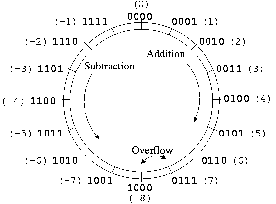
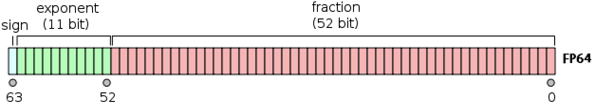
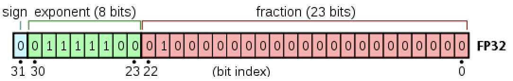
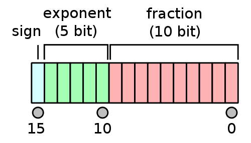
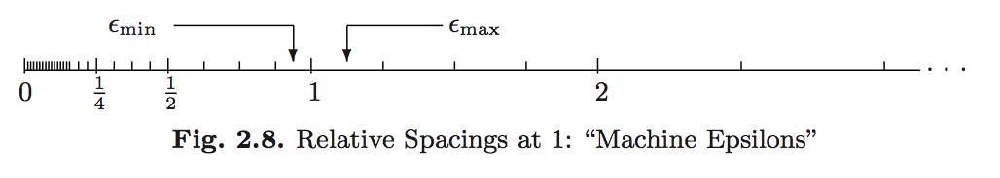

## Goals

1. Develop an understanding of how numbers are represented on a computer.
2. Gain an awareness of the failure modes of computer number systems.

## Integers: Fixed-Point System

- Fixed-point number system is a computer model for integers $\mathbb{Z}$.
- The number of bits and method of representing negative numbers vary from system to system.
- NumPy has several integer types: `np.int8`, `np.int16`, `np.int32`, `np.int64` and their unsigned `np.uintX` relatives.

```{python}
import numpy as np
```

### Signed Integers

- First bit indicates sign.
    - `0` for nonnegative numbers
    - `1` for negative numbers
- **Two's complement representation** for negative numbers.
    - Sign bit is set to `1`.
    - Remaining bits are set to opposite values
    - `1` is added to the result
    - Two's complement representation of a negative integer `x` is same as the unsigned integer `2^64 + x`.


Two's complement representation respects modular arithmetic. Adding any two signed integers is just bitwise addition, possibly module $2^{M}$.

{fig-align="center" width=40%}

Arithmetic (addition, subtraction, multiplication) on integers is exact except for the possibility of overflow.

The **range** of representable integers by an $M$-bit **signed integer** is $[-2^{M-1}, 2^{M-1}-1]$.

```{python}
np.iinfo(np.int64)
```


### Unsigned Integers

**Unsigned integers** use all $M$ bits to represent non-negative integers. Their range is $[0, 2^{M}-1]$.

```{python}
np.iinfo(np.uint8)
```


### Overflow Behavior

What happens when an arithmetic operation results in a value outside the representable range?
This is known as **overflow behavior** and it varies across programming languages.

```{python}
# not the same as Python's native `int`
np.iinfo(np.int64).max
```

```{python}
x = np.iinfo(np.int64).max + np.int64(1)
x
```

```{python}
type(x)
```

This example shows that NumPy's `intX` types will wrap around from one extreme of the representable range to the other.


## Real Numbers: Floating-Point System

The floating-point number system is a computer model for real numbers $\mathbb{R}$.

- Most computer systems adopt the [IEEE 754](https://en.wikipedia.org/wiki/IEEE_754) standard, established in 1985, for floating-point arithmetics.
    - For the history, see an interview with [William Kahan](https://people.eecs.berkeley.edu/~wkahan/ieee754status/754story.html).
    - His [personal website](https://people.eecs.berkeley.edu/~wkahan/MxMulEps.pdf) records his advocacy for better computing and education about computing throughout time.
- In the scientific notation, a real number is represented as 

    $$
    \pm d_{0} . d_{1} d_{2} \cdots d_{p} \times b^{e}.
    $$

    On a computer, the **base** is $b = 2$ and the digits $d_{i}$ are one of $0$ or $1$.

- A **normalized** floating-point number has $d_{0} \neq 0$. For example, $+1.0010 \times 2^{4}$.
- A **denormalized** numbers has $d_{0} = 0$. For example, $0.1001 \times 2^{5}$ (equivalent).
- Under this system, a computer must keep track of
    - The *sign bit*.
    - The *fraction* (or mantissa, significand) of the *normalized* representation.
    - The actual *exponent* $e$ plus a *bias*.

As with integers, there are several floating point types.

### Double Precision `Float64`

{fig-align="center" width=70%}

Double precision (64 bits = 8 bytes) numbers are the dominant data type in **scientific computing**.

- Bit on the left is the sign bit.
- $p = 52$ significant bits.
- 11 bits for the exponent $e$. This means $e_{\mathrm{min}} = -1022$ and $e_{\mathrm{max}} = 1023$. The **bias** is $1023$.
- Note that $e_{\mathrm{min}} - 1$ and $e_{\mathrm{max}} + 1$ are reserved for special numbers.
- Range for magnitude: $10^{\pm 308}$ in *decimal notation* because $\log_{10}(2^{1023}) \approx 308$.
- Double precision numbers are precise up to about the $-\log_{10}(2^{-52}) \approx 15$ decimal point.

```{python}
np.finfo(np.float64)
```

```{python}
np.float64(1.0)
```


### Single Precision `Float32`

{fig-align="center" width=60%}

- $p = 23$ significant bits.
- $8$ exponent bits: $e_{\mathrm{min}} = -126$ and $e_{\mathrm{max}} = 127$. Bias is 127.
- Also reserves numbers at the extreme ends.
- Range for magnitude: $10^{\pm 38}$ in *decimal notation* because $\log_{10}(2^{127}) \approx 38$.
- Precise up to about the $-\log_{10}(2^{-23}) \approx 7$ decimal point.


### Half-Precision `Float16`

{fig-align="center" width=20%}

- $p = 10$ significant bits.
- $5$ exponent bits: $e_{\mathrm{min}} = -14$ and $e_{\mathrm{max}} = 15$. Bias is 15.
- Also reserves numbers at the extreme ends.
- Range for magnitude: $10^{\pm 4}$ in *decimal notation* because $\log_{10}(2^{15}) \approx 4$.
- Precise up to about the $-\log_{10}(2^{-10}) \approx 3$ decimal point.


### Special Floating-Point Numbers

#### Infinity: `+Inf` and `-Inf`

Exponent $e_{\mathrm{max}} + 1$ (exponent bits all 1) with a zero mantissa means $\pm \infty$

```{python}
np.inf
```

```{python}
-np.inf
```


#### Not a Number: `NaN`

Exponent $e_{\mathrm{max}} + 1$ (exponent bits all 1) with a nonzero mantissa means `nan`. `nan` could be produced from `0 / 0`, `0 * Inf`, $\ldots$

```{python}
np.nan
```


- Note that `nan` $\neq$ `nan`.
- In fact, `x == nan` is **always** `false`.
- Use `np.isnan()` to check for "not a number".

#### Zero `0`

Exponent $e_{\mathrm{min}} - 1$ (exponent bits all 1) with a zero mantissa represents the real numbrer $0$.


There are some special rules in IEEE 754 for [signed zeros](https://en.wikipedia.org/wiki/Signed_zero).
Exponent $e_{\mathrm{min}} - 1$ (exponent bits all 1) with a nonzero mantissa represents numbers less than $b^{e_{\mathrm{min}}}$. Thus, numbers are *denormalized* in the range $(0, b^{e_{\mathrm{min}}})$. This is **graceful underflow**.


### Rounding

Rounding is necessary whenever a number has more than $p$ significand bits. Most computer systems use the default IEEE 754 **round to nearest** mode (also called **ties to even** mode). For example, the number 0.1 in decimal system cannot be represented accurately as a floating point number:
$$
0.1 = 1.\underbrace{1001}_\text{repeat}\underbrace{1001}... \times 2^{-4}
$$


For a number with mantissa ending with ...001(100..., all 0 digits after), it's a tie and will be rounded to ...010 to make the mantissa even.


### Overflow and Underflow Behavior

For double precision, the range is $\pm 10^{\pm 308}$. In most situations, underflow (magnitude of result $<$ $10^{-308}$) is preferred over overflow (magnitude of result $>$ $10^{308}$) because the latter produces $\pm \infty$. On the other hand, underflow yields zeros or denormalized numbers.


#### Example: Logit link

The logit link function is

$$
p(x) = \frac{\exp (x^T \beta)}{1 + \exp (x^T \beta)} = \frac{1}{1+\exp(- x^T \beta)}.
$$

It is commonly used in *logistic regression*, *binary classification*, and is generalized by the [softmax function](https://en.wikipedia.org/wiki/Softmax_function) (ubiquitous in machine learning).
The former expression can easily lead to `Inf / Inf = NaN`, while the latter expression leads to graceful underflow.


### Machine epsilons

These are the spacings of numbers around 1 (depending on floating-point precision):
$$
\epsilon_{\min}=b^{-p}, \quad  \epsilon_{\max} = b^{1-p}.
$$

{fig-align="center" width=50%}

```{python}
np.finfo(np.float64).eps
```


## What goes wrong?

### Scenario 1: Roundoff Error

Addition or subtraction of two numbers of widely different magnitudes: $a+b$ or $a-b$ where $a \gg b$ or $a \ll b$. We lose the precision in the number of smaller magnitude.

Consider 

$$
\begin{eqnarray*}
    a &=& x.xxx ... \times 2^{30} \\  
    b &=& y.yyy... \times 2^{-30}
\end{eqnarray*}
$$

What happens when computer calculates $a+b$? We get $a+b=a$!

```{python}
a = np.float64(2.0) ** 30
b = np.float64(2.0) ** -30
a + b == a
```

```{python}
a
```

```{python}
b
```

### Scenario 2: Catastrophic Cancellation

Subtraction of two nearly equal numbers eliminates significant digits. $a-b$ where $a \approx b$. Consider 

$$
\begin{eqnarray*}
    a &=& x.xxxxxxxxxx1ssss  \\
    b &=& x.xxxxxxxxxx0tttt
\end{eqnarray*}
$$

The result is $1.vvvvu...u$ where $u$ are unassigned digits. *Rember that this is a binary representation, not a decimal number!*

```{python}
a = np.float32(1.2345678)
b = np.float32(1.2345677)
a - b
```

This error, while small in absolute terms, represents a large loss of precision.


## Implications for Computing

- **Rule 1**: Add small numbers together before adding larger ones.
- **Rule 2**: Add numbers of like magnitude together (paring). When all numbers are of same sign and similar magnitude, add in pairs so at each stage the summands are of similar magnitude.
- **Rule 3**: Avoid subtraction of two numbers that are nearly equal.
