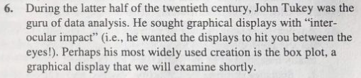
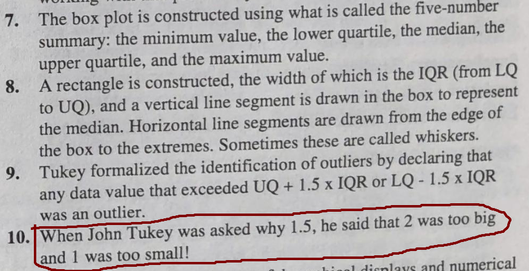

## Goals

1. Understand the difference between **imperative** (`matplotlib`) and **declarative** (`seaborn`) plotting, and when to use each.
2. Practice plotting with three basic visualizations: the histogram, the boxplot, and the scatterplot.
3. Understand visualization as a tool for identifying structure.
4. Recognize forms in which Simpson's paradox can manifest.

## Overview

```{python}
import os
import numpy as np
import pandas as pd
import matplotlib.pyplot as plt
import seaborn as sns
```

- `matplotlib` is a Python library for an **imperative programming** approach to plotting.
    + The user is responsible for instructing the computer *how to build a plot* using the library's primitives.
    + Highly flexible, but really verbose code.
    + `matplotlib` is a massive library. We typically only work with `matplotlib.pyplot`.
    + Canonical abbreviation: `plt`.
- `seaborn` is built on `matplotlib` to support a **declarative programming** approach to plotting.
    + The user instructs the computer *what to build* using the library's primitives.
    + We don't see the details (initialize the `Figure` and `Axis`...), but lose some flexibility.
    + Canonical abbreviation: `sns`.

For our purposes, `seaborn` is the most useful tool.
Just keep in mind that `matplotlib` is the engine that makes the clean `seaborn` interface possible.
We may need to create our own custom interfaces on data analysis projects.

## Dataset

We'll continue to explore the Palmer Penguins data.
Here we define a default style and fix the penguin colors to specific values.
These colors should be friendly to different forms of colorblindness.

```{python}
penguins = pd.read_csv(os.path.join("assets", "penguins.csv"))
penguins = penguins.dropna(subset=["body_mass_g"])

# COLORS is a 'constant', so I prefer to use uppercase 
# to distinguish this variable name from others I might use
# in a quick-prototyping context
COLORS = {"Adelie": "#EA9839", "Chinstrap": "#984AE5", "Gentoo": "#469093"}
sns.set_theme(style="whitegrid")
```


## Basic Elements

A `matplotlib` figure has two parts:

- a **figure** (the canvas) and,
- one or more **axes** (the panels with a coordinate system on them).

The general workflow is:

1. Create both objects first.
2. Draw on individual axes as needed (often using a loop).
3. Add any annotations like axis labels, titles, or legends. Usually coupled with drawing on axes.

The [`matplotlib` documentation](https://matplotlib.org/stable/users/explain/quick_start.html) has an excellent quick start guide to help you become familiar with the basic elements.

```{python}
# INITIALIZE: Lots of ways to do this. 
fig, ax = plt.subplots(nrows = 1, ncols = 1, figsize=(6, 4))

# DRAW: Generally use NumPy arrays or Pandas Series/DataFrames as figure data.
ax.scatter(penguins["flipper_length_mm"], penguins["body_mass_g"], alpha=0.6)

# ANNOTATE: Provide the reader with helpful context
ax.set_xlabel("Flipper length (mm)")
ax.set_ylabel("Body mass (g)")
ax.set_title("Heavier penguins have longer flippers")
ax.annotate("alpha = 0.6", xy = (180, 6000))

# Nothing is displayed until you request it.
plt.show()
```

- `alpha=0.6` makes points partly transparent, so overlapping points are visible.
- Label your axes with units (if relevant). Give your plots an informative title.
- You can also add text annotations with `.annotate()`. Notice that the coordinates are based on the data values.

## Histograms

A **histogram** partitions numeric data into *bins* and counts how many observations fall in each.
This allows us to visualize the distribution of a single variable within our data.

```{python}
# INITIALIZE
fig, ax = plt.subplots(figsize=(6, 4))

# DRAW
ax.hist(penguins["bill_length_mm"], bins=20, edgecolor="white")

# ANNOTATE
ax.set_xlabel("Bill length (mm)")
ax.set_ylabel("Count")
ax.set_title("Distribution of bill length, all penguins")

plt.show()
```

The number of bins is a choice, and it changes what you see:

```{python}
# INITIALIZE
fig, axes = plt.subplots(1, 3, figsize=(11, 3.2), sharey=False)

for ax, bins in zip(axes, [4, 20, 80]):
  # DRAW
  ax.hist(penguins["bill_length_mm"], bins=bins, edgecolor="white")

  # ANNOTATE
  ax.set_title(f"{bins} bins")
  ax.set_xlabel("Bill length (mm)")

# This is helpful to eliminate extra padding/spacing at the end.
fig.tight_layout()

plt.show()
```

- **Too few bins**: Each bin captures a wide range so we miss small changes in the shape of the data's distribution.
- **Too many bins**: Each bin tends to capture only a few values and gives the perception of highly complex distributional pattern.
- Examine your assumptions as you calibrate the bins.
    + *Example*: Do we believe there are several distinct modes? Or only a few?
    + *Example*: Is the data symmetric? Or is it skewed in one direction?
    + How does your perception change your answers to these questions as you change the bin number?
- You may need to experiment with a few values.
    + Make the computer work for you. Our basic `for` loop above lets us easily explore different values.
    + It's useful to write functions for specific plots so it works well in these kinds of loops.
- Can also provide a `str` value to apply different heuristics in selecting the number of bins:
    + `fd`: [Freedman-Diaconis rule](https://en.wikipedia.org/wiki/Freedman%E2%80%93Diaconis_rule).
    + `sturges`: [Sturges' rule](https://en.wikipedia.org/wiki/Sturges%27s_rule).

### `seaborn` version

Let's add the color variable.
`seaborn` provides flexibility in how we specify a figure.

- `data` keyword: Provide a source for information.
- `x` keyword: Specify what information is mapped to the $x$-axis.
- `hue` keyword: Specify what information is mapped to distinct colors. Needs *categorical data*.
- Can also use arrays as in `matplotlib`.

```{python}
# INITIALIZE
fig, axes = plt.subplots(1, 2, figsize=(11, 4), sharey=True)

# FIGURE 1: All penguins
sns.histplot(data = penguins, x = "bill_length_mm", bins = 25, ax = axes[0])
axes[0].set_title("All penguins")

# FIGURE 2: Bill Length (mm) by Species
sns.histplot(data = penguins, x = "bill_length_mm", hue = "species",
  hue_order = list(COLORS),
  palette = COLORS,
  bins = 25,
  multiple = "stack",
  ax = axes[1]
)
axes[1].set_title("Colored by species")

for ax in axes:
    ax.set_xlabel("Bill length (mm)")

fig.tight_layout()
plt.show()
```

- **Left**: "Wide" distribution. Possible in principle, but the apparent peaks suggest additional structure.
- **Right**: Each species has its own distribution with different centers and widths.
- The stacked format is used for convenience here. Can hide information; e.g. how wide is the Adelie distribution?
- How would you recover the picture on the right if you did not have the `species` labels?

## Boxplots

A **boxplot** summarizes a variable's distribution with a few informative statistics.
This is *potentially* richer than a table, and can be useful in comparing groups.
Use this plot type only when it is actually more informative than the corresponding table!



General idea:

- $x$-axis is used to convey information about categorical variable used to group numeric data.
- $y$-axis conveys the numeric variable's information.
- In principle, you can swap $x$ and $y$ axis. Use whatever is easiest to read.

The **descriptive statistics** conveyed by a boxplot are

- a measure of *location* or *center*,
- a measure of *deviation* or *spread*, and
- *skewness*, through the *symmetry/asymmetry of quartiles*.

### `seaborn` version

```{python}
fig, ax = plt.subplots(figsize=(6, 4))

sns.boxplot(data = penguins, x = "species", y = "body_mass_g",
  order = list(COLORS),     # Ordered list specifying order along x-axis
  hue = "species",
  hue_order = list(COLORS), # Same idea as `order`
  palette = COLORS,
  legend = False,           # This would be redundant. Set it to `True` to see why.
  ax = ax
)

ax.set_xlabel("Species")
ax.set_ylabel("Body mass (g)")
ax.set_title("Body mass by species")

plt.show()
```

### Reading a boxplot

- The *line* inside the box is the **median**.
- The *box* ranges from the **first quartile**, $Q_1$ (25% of the data lie below it), to the **third quartile**, $Q_3$ (75% lie below it). Each box represents the middle 50% of the data. Its height is the **interquartile range**, $\text{IQR} = Q_3 - Q_1$.
- The *whiskers* indicate a range of values that might not be considered "too extreme".
    + No farther than 1.5 times IQR below $Q_1$ or above $Q_3$.
- Any *points* or *dots* outside the whiskers are flagged as **potential outliers**.

We can compute the cutoffs ourselves for one species:

```{python}
adelie = penguins.loc[penguins["species"] == "Adelie", "body_mass_g"]
q1, q3 = adelie.quantile([0.25, 0.75])
iqr = q3 - q1

pd.Series(
  [q1, q3, iqr, q1 - 1.5 * iqr, q3 + 1.5 * iqr, adelie.min(), adelie.max()],
  index = ["Q1", "Q3", "IQR", "LB", "UB", "Min", "Max"]
)
```

No Adelie penguin has body mass outside the whisker range, so there are no points or dots shown for that box.


### Why do we use 1.5 IQR?

The boxplot is the invention of American statistician [John Tukey](https://en.wikipedia.org/wiki/John_Tukey).
He was a vocal advocate for building visualization tools and is credited with the term "bit".



- There are various, well-informed heuristics for identifying outliers. Such rules do not prove a data point is in fact an outlier!
- Tukey's 1.5 rule is somewhat arbitrary, but it is based on the following facts:
    + If data are approximately normal with mean $0$ and variance $1$, then $Q_{1}$ and $Q_{3}$ correspond to $-0.6745$ and $+0.6745$, respectively.
    + Thus, you can show that $\mathrm{IQR}$ is approximately equal to $2 \times 0.6745 \sigma$ for approximately normal data.
    + Any data points that is roughly $\pm 2.7$ standard deviations away from the mean gets flagged as a potential outlier.

The points flagged by a boxplot should prompt you to examine those data points (e.g. look at the other variables' values).

### `matplotlib` version

The imperative approach is quite verbose.
It is worth seeing this once to appreciate the utility of the `seaborn` interface:

```{python}
fig, ax = plt.subplots(figsize=(6, 4))
species_names = list(COLORS)

# Create a list the contains data for each box
data = [penguins.loc[penguins["species"] == s, "body_mass_g"] for s in species_names]

# The list of arrays can be passed to `.boxplot()`.
# What is `patch_artist`? This feature needs to be used so we can edit the display of the median line.
parts = ax.boxplot(data,
  tick_labels = species_names,
  patch_artist = True,
  medianprops = dict(color = "black", linewidth = 2)
)

# This is needed to set the colors of each box... How tedious!
for patch, name in zip(parts["boxes"], species_names):
  patch.set_facecolor(COLORS[name])
  patch.set_alpha(0.8)

ax.set_xlabel("Species")
ax.set_ylabel("Body mass (g)")
ax.set_title("Body mass by species")

plt.show()
```

- Examine this figure and compare to the `seaborn` version.
- What are defaults might `seaborn` have set for us? There is at least one visual element that is different.

## Scatterplots

A **scatterplot** displays two numeric variables plotted against each other, one variable per axis.
It useful for probing potential relationships, specifically associations, between variables.

The `seaborn` interface allows you to fit linear trend lines to data.

+ This is done via *regression*, and it is not limited to linear trends.
+ We will review simple learning regression later in the course.
+ A *positive slope* indicates a **positive correlation**. Both variables "move together."
+ A *negative slope* indicates a **negative correlation**. The two variables "move in opposite directions."

### `matplotlib` version

```{python}
x = penguins["bill_length_mm"]
y = penguins["bill_depth_mm"]

# NumPy's `polyfit` can fit different trend lines
slope, intercept = np.polyfit(x, y, deg = 1)

fig, ax = plt.subplots(figsize=(6, 4))

# DRAW: Scatterplot of data
ax.scatter(x, y, alpha=0.6)

# DRAW: Trend line
xs = np.linspace(x.min(), x.max(), 50)
ax.plot(xs, intercept + slope * xs, color="red", linestyle="--")

ax.set_xlabel("Bill length (mm)")
ax.set_ylabel("Bill depth (mm)")
ax.set_title("All penguins together")

plt.show()
```

### `seaborn` version

```{python}
fig, ax = plt.subplots(figsize=(6, 4))

sns.regplot(
  data = penguins,
  x = "bill_length_mm",
  y = "bill_depth_mm",
  ci = None, # no confidence band; don't use this blindly!
  scatter_kws = {"alpha": 0.6},
  line_kws = {"color": "red", "linestyle": "--"},
  ax = ax,
)

ax.set_xlabel("Bill length (mm)")
ax.set_ylabel("Bill depth (mm)")
ax.set_title("All penguins together")

plt.show()
```

## Simpson's paradox

**Observation:** Across all penguins in our data, longer bills tend to go with *shallower* bills, as suggested by our scatterplots.
Does this actually happen to individual penguins?
Let us add the third variable we have been ignoring.

### `matplotlib` version

We color each point by `species` and fit separate trend lines:

```{python}
fig, ax = plt.subplots()

for species, color in COLORS.items():
  sub = penguins[penguins["species"] == species]
  
  # DRAW: Scatterplot for particular species
  ax.scatter(sub["bill_length_mm"], sub["bill_depth_mm"],
    color = color,
    alpha = 0.7,
    label = species
  )

  # DRAW: Species-specific trend line
  m, b = np.polyfit(sub["bill_length_mm"], sub["bill_depth_mm"], deg = 1)
  xs = np.linspace(sub["bill_length_mm"].min(), sub["bill_length_mm"].max(), 50)
  ax.plot(xs, b + m * xs, color=color, linewidth=2)

ax.set_xlabel("Bill length (mm)")
ax.set_ylabel("Bill depth (mm)")
ax.set_title("Penguin bill dimensions by species")
ax.legend(title="Species")

plt.show()
```


### `seaborn` version

The `lmplot` function draws a scatterplot with a fitted line for each value of `hue`:

```{python}
# No initialization; this function creates its own canvas (`Figure` and `Axis`) by default.
sns.lmplot(data = penguins, x = "bill_length_mm", y = "bill_depth_mm", hue = "species",
  hue_order = list(COLORS),
  palette = COLORS,
  ci = None,
  aspect = 1
)

plt.show()
```

### Why does this happen?

The apparent trend reverses once we include group information!
Each penguin species clearly shows a positive correlation between bill depth and bill length.
The negative slope in the previous scatterplots came from combining three clusters that sit in different places.

```{python}
penguins[["bill_length_mm", "bill_depth_mm"]].mean().round(1)
```

```{python}
penguins.groupby("species")[["bill_length_mm", "bill_depth_mm"]].mean().round(1)
```

The different species differ considerably in both variables.

- Gentoo penguins have long, shallow bills
- Adelie penguins have short, deep bills.

Differences *between* the groups produced a downward trend when viewing the data without overlaying group structure
The relationship *within* each group, however, clearly has a positive trend.

This is an instance of **Simpson's paradox**, which is the phenomenon of reversing or eliminating trends within two variables once a third variable is included.

- The third variable can be categorical or continuous.
- Neither view is "wrong" as far as the mathematics are concerned.
- The way to resolve the apparent paradox is to understand that a statistic, regardless of whether it is a single number of a trend, is inherently a summary *about a population*, not about individual observations.
- What matters in practice is being clear about **which population you are interested in investigating**.

Notice that not every relationship reverses.
Body mass and flipper length rise together for all penguins *and* within each species, but the strength differs.


## Quick plotting with `pandas`

`pandas` data frames have plotting implemented as a method.
It is convenient for quick prototyping and exploratory analysis in a REPL.
Each call returns a customizable axis object from `matplotlib`.

```{python}
ax = (penguins["body_mass_g"]
  .plot(kind = "hist", bins = 25, edgecolor = "white")
)

ax.set_xlabel("Body mass (g)")
ax.set_title("Body mass distribution for Palmer Penguins")

plt.show()
```

A **scatter matrix** is useful if you want a quick look of several numeric variables at once.
Keep in mind that this is a screening tool:

- It merely suggests relationships and clusters worth a closer look.
- It can be misleading, even if you factor in categorical variables, because it displays data in a pairwise fashion. 

```{python}
numeric_cols = ["bill_length_mm", "bill_depth_mm", "flipper_length_mm", "body_mass_g"]

pd.plotting.scatter_matrix(penguins[numeric_cols],
  c = penguins["species"].map(COLORS),  # Color each point by its species
  diagonal = "hist",                    # Control the display along the diagonal
  alpha = 0.7,
  figsize = (8, 8),
)

plt.tight_layout()
plt.show()
```

- Might need to adjust `figsize` to correctly display all visual elements.
- With $p$ variables there are $p^2$ panels, so this is only viable for examining a few variables.

## Saving a figure

```{python}
#| eval: false
# Create a directory to store our work; don't do anything if it already exists.
os.makedirs("output", exist_ok = True)

# Use the `.savefig()` method for a `Figure` object
fig.savefig(
  os.path.join("output", "bill_scatter.png"),
  dpi = 200,            # Dots per inch; resolution
  bbox_inches = "tight" # Control the bounding box
)
```

## Takeaway messages

- Always plot grouped data if the structure is given to you.
    + Summaries and correlations over a mixture might not describe any of those groups.
- It is difficult for humans to intuit latent structure from numeric summaries alone. Plots often provide a richer, high-level summary.
- Apparent clusters in your visualizations are rarely an accident.
    + Ask what the groups might exist, and whether they might labeled somehow.
    + Use visualizations to help guide and sharpen your analysis.
- Use `seaborn` for fast exploration and `matplotlib` when you need to control the details.

## Exercises

### Exercise 1: One variable

1. Make a histogram of `flipper_length_mm` with 30 bins. Describe its shape in one sentence.
2. Make the same histogram with `seaborn`, colored by species. Is this more or less informative?

### Exercise 2: Groups

1. Make a boxplot of `flipper_length_mm` by `island`.
2. Make a second boxplot of `flipper_length_mm` by `species`. Which grouping better separates the flipper lengths? Why might the island plot be misleading?

### Exercise 3: Associations

1. Make a scatterplot of `body_mass_g` ($y$-axis) against `flipper_length_mm` ($x$-axis), colored by species. Include a trend line for each species.
2. Does the overall relationship reverse within species, as the bill example did, or only change in strength? Justify your answer by computing correlations using `groupby` on the Pandas data frame.
3. Which of the three species shows the weakest association?
