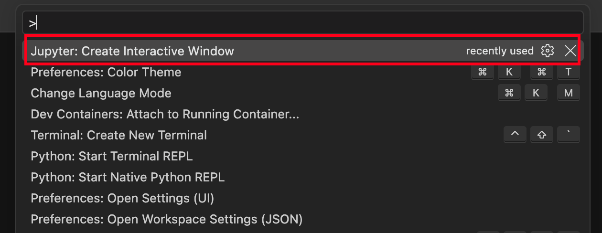
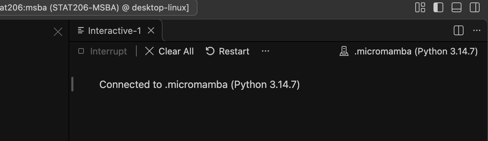
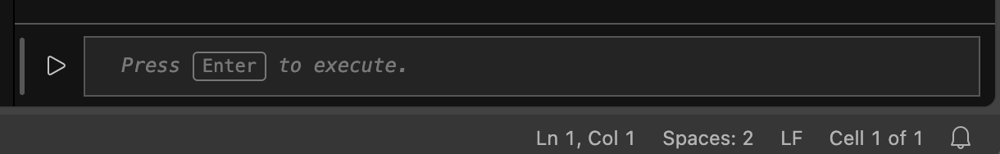
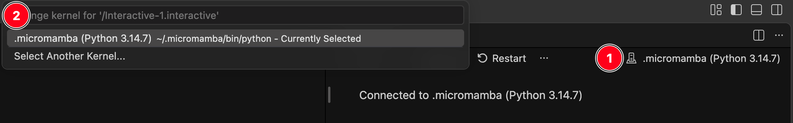
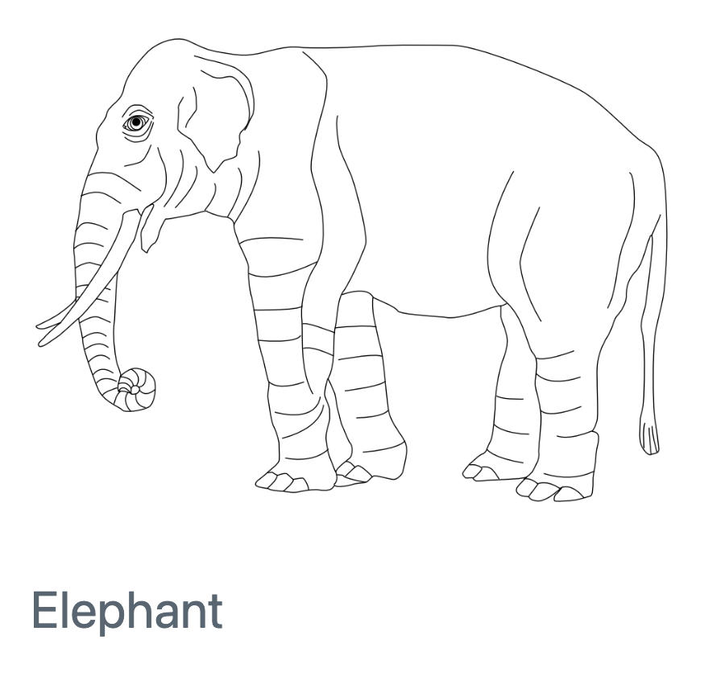

## Goals

1. Verify that your container environment has `matplotlib` and `seaborn` installed.
2. Learn a basic workflow to quickly prototype graphics.
3. Learn how to use Quarto to integrate figures into a report.

## Interactive Plotting with Jupyter

Our container environment cannot display graphics through an interactive viewer pane.
Instead, we can use an interactive Jupyter environment to quickly prototype plots.

### 1. Start a Jupyter window

- Open the Command Palette (Windows: <kbd>Ctrl</kbd> + <kbd>Shift</kbd> + <kbd>P</kbd>, MacOS: <kbd>Cmd</kbd> + <kbd>Shift</kbd> + <kbd>P</kbd>)
- Type in `Jupyter: Create Interactive Window`. You can type this in partially to take advantage of the fuzzy search feature.
- Select the option.

{fig-align="center" width="80%"}

If this option is not available, you may be missing the Jupyter VSCode extension.

### 2. Check the kernel.

A new window should open within VSCode. For example:

{fig-align="center" width="80%"}

Check that `.micromamba (Python 3.14.7)` is shown in the top-right corner.
The bottom of this window has a section where you can type in Python code.

{fig-align="center" width="80%"}

### 3. Fixing the kernel choice (as needed)

If you did not see `.micromamba (Python 3.14.7)`:

{fig-align="center" width="80%"}

1. Click on small tower icon. This should open a new dialogue.
2. Look for the `.micromamba (Python 3.14.7)` option.
    - Select `Select Another Kernel...`
    - Select `Python Environments...`
    - Select `.micromamba (Python 3.14.7) ~/.micromamba/bin/python`

## Installing Packages

### Verify Installations

You will need to open a Jupyter session and a regular Terminal window.
Follow the instructions given here to install any required software, as documented here.

To help you (and us) troubleshoot any errors, check that

```{text}
which micromamba
```

returns

```{text}
micromamba () {
        __mamba_wrap "$@"
}
```

---

First, let's check that you can load `matplotlib`.
Run the following code in a Jupyter session within VSCode:

```{python}
import matplotlib.pyplot as plt
import numpy as np

x = np.linspace(0, 10, 100)
y = np.sin(x)

plt.plot(x, y)
plt.show()
```

If this fails, jump to [Install: `matplotlib`](#install-matplotlib).

---

Now let's check that you can load `seaborn`.
It is built on top of `matplotlib` so you will generally have to load both packages if you use `seaborn`.
Enter the following in a Jupyter session:

```{python}
import matplotlib.pyplot as plt
import numpy as np
import seaborn as sns

sns.set_theme()

x = np.linspace(0, 10, 100)
y = np.sin(x)

sns.lineplot(x=x, y=y)
plt.show()
```

This is expected to fail.
Jump to [Install `seaborn`](#install-seaborn) to fix it.

### Install: `matplotlib`

In a Terminal window, type and run the command

```{text}
micromamba install -n base -c conda-forge 'matplotlib-base'
```

Follow and accept any prompts given.

### Install: `seaborn`

In a Terminal window, type and run the command

```{text}
micromamba install -n base -c conda-forge 'seaborn=0.13.2'
```

Follow and accept any prompts given.

## Working with Quarto

As shown in the previous sections, running `plt.show()` will cause a Quarto code chunk to display a figure at the bottom of the code chunk.
In general, you may need to exercise control over the display of figures in a report.
See the [Quarto documentation](https://quarto.org/docs/authoring/figures.html) for a full list of features.
The following is a brief review of options you are most likely to need.

### Including a saved file

Some of the images in this document are screenshots.
You can include an image using the following Markdown syntax:

```{text}

```

Here's the elephant example from the Quarto documentation:



#### Resizing

Add additional parameters using curly braces `{}`.
For example, you can resize a figure with the `width` attribute:

```{text}
{width="20%"}
```

{width="20%"}

#### Alignment

You can also change figure alignment to `"left"`, `"center"`, or `"right"`.
Notice that you can edit multiple attributes by separating them with spaces.

```{text}
{fig-align="left" width="40%"}
```

{fig-align="left" width="40%"}